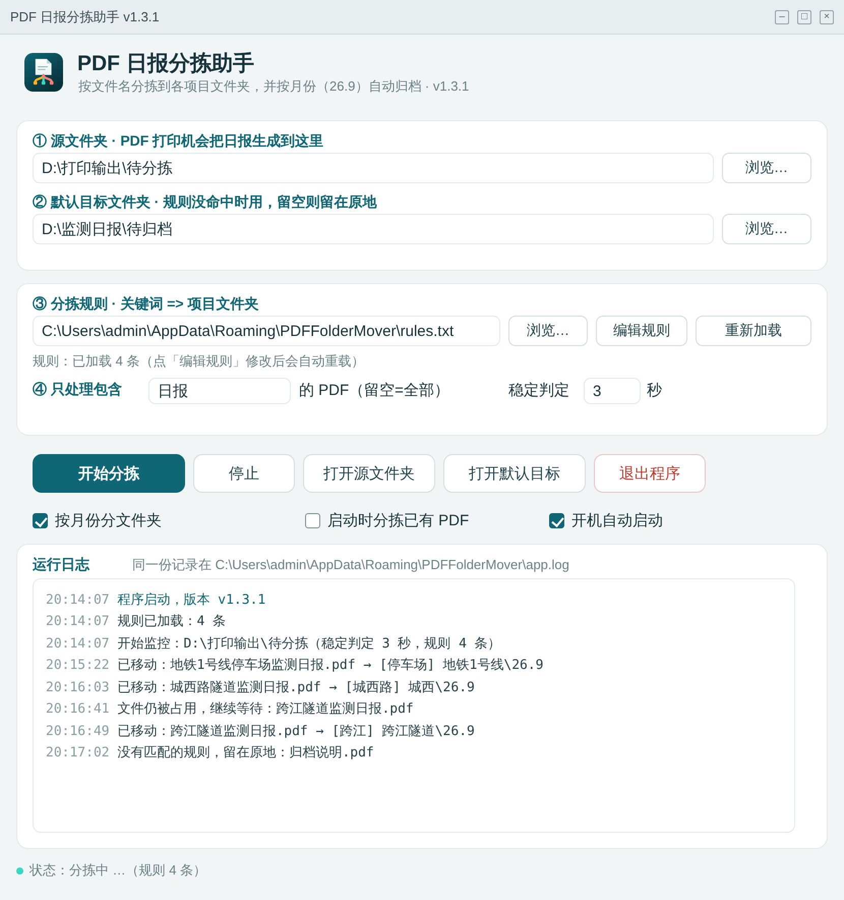

<div align="center">


[](https://github.com/Tbe1998/pdf-report-sorter/actions/workflows/build.yml)

# PDF 日志分拣助手

**把"打印出来的 PDF 日报"自动分到对应项目的文件夹里——等到文件真正写完再动手。**

Windows 单文件 exe · 零依赖 · 中文界面 · 托盘后台 · 自动更新

</div>



## 它解决什么问题

工程监测/内业岗位每天要把多个项目的日报 PDF 打印归档。Microsoft Print to PDF 之类的虚拟打印机不是"生成完才落盘"，而是一边渲染一边往里写——很多整理工具会在文件还没写完时就把文件搬走，结果得到一个损坏的 PDF。

这个工具只做一件事，但把这件事做对：

> 盯着打印输出文件夹 → 等到 PDF **真正确认写完** → 按文件名里的项目关键词 → 移动到该项目文件夹。

## 特性

- **反复确认写完才移动**：三重判断，见下方"判定逻辑"
- **按文件名路由到多个项目**：一行一条规则，关键词命中即分流，最长关键词优先
- **按月份自动归档**：项目文件夹下再分一层 `26.9` / `26.10`，月份文件夹不存在自动创建
- **不会覆盖同名文件**：目标已存在时自动重命名为 `报告 (2).pdf`
- **只搬启动后新生成的文件**：源文件夹里原有的历史文件默认不动（可勾选连旧的也搬）
- **关闭窗口 = 退到托盘继续工作**：真正退出走托盘菜单或界面按钮
- **开机自启**（可选）
- **单文件 exe**：不需要安装 Python / .NET / 运行库，双击即用
- **整包自动更新**：地址写死在程序里，界面上不暴露

## 判定逻辑（核心）

程序每 1 秒扫描一次源文件夹，只有**同时满足**下面三条才会移动：

1. 文件大小与修改时间连续 `N` 秒（默认 3 秒）没有变化；
2. 能以**独占方式**打开文件（Windows 上正被写入的文件拿不到独占句柄）；
3. 文件名包含配置的过滤词（默认不限制）。

任意一条不满足就继续等，因此打印机分几次写入、写几十秒的大文件都不会被搬半成品。

冒烟自检：`PDF文件夹搬运助手.exe --selftest`（在临时目录模拟"边写边监听"，不碰你的真实文件夹）。

## 按月份归档

目标文件夹下会再分一层"两位年.月"的子文件夹（月份不补零）：

```
D:\监测日报\地铁1号线停车场\
├─ 26.9\
│   └─ 地铁1号线停车场监测日报2026-09-30.pdf
└─ 26.10\
    └─ 地铁1号线停车场监测日报2026-10-08.pdf
```

- 月份**优先取文件名里的日期**，支持 `2026-09-30`、`2026/9/30`、`2026.09.30`、`2026年9月30日`、`20260930`、`2026-09`、`2026年9月`；同名多日期取最后一个；
- 文件名里没有日期时，退回**文件修改时间**（打印落盘时间），日志会提示一句；
- 月份文件夹不存在会自动创建（`MkdirAll`），已存在直接复用；
- 界面上的「按月份分文件夹」可以关掉，关掉后恢复"直接放进项目文件夹"。

## 分拣规则

规则是一个纯文本文件，一行一条：

```
# 关键词1,关键词2 => 目标文件夹
地铁1号线,停车场 => D:\监测日报\地铁1号线停车场
隧道,隧洞 => D:\监测日报\隧道工程
桥梁,特大桥 => D:\监测日报\桥梁工程
```

- 文件名包含任一关键词即命中，**不区分大小写**；
- 多条规则同时命中时，取**最长关键词**那条（`城西路隧道` 优先于 `隧道`）；
- 都没命中 → 走"默认目标文件夹"；默认目标为空 → 原地不动并记日志；
- 目标文件夹不存在 → 跳过并记日志，不丢文件；
- 规则文件保存后约 2 秒自动重载，也可以点"重新加载"。

## 使用

1. 下载 Release 里的 zip，解压到任意目录（建议不要放在 C 盘根目录）；
2. 双击 `PDF文件夹搬运助手.exe`；
3. ① 选打印输出文件夹（虚拟打印机保存 PDF 的位置）；
4. ③ 选规则文件（可用包内的 `规则示例.txt` 改）；
5. 点「开始分拣」，然后照常打印；
6. 打印完成后，PDF 会在几秒内出现在对应项目文件夹里。

关闭窗口不会退出，程序在托盘里继续跑；双击托盘图标可以叫回窗口。

## 构建

需要 Go 1.22+，纯 Win32 API（无第三方 GUI 库）：

```bash
# 图标资源（可选，rsrc 生成 syso 后才有 exe 图标）
go install github.com/akavel/rsrc@latest
rsrc -ico app.ico -o rsrc_windows_amd64.syso

# 构建
GOOS=windows GOARCH=amd64 CGO_ENABLED=0 go build -trimpath -ldflags "-H windowsgui -s -w" -o PDF文件夹搬运助手.exe .
```

`build.bat` 是 Windows 本机一键打包脚本。

## 自动构建（GitHub Actions）

推送到 `main` 或提 PR 时，[build.yml](.github/workflows/build.yml) 会自动：

1. `go vet` + `go test ./...`（Ubuntu，覆盖跨平台逻辑）；
2. Windows 上安装 `rsrc` 嵌入图标，先编译控制台版跑 `--selftest-console` 冒烟自检；
3. 编译无窗口主程序，连同使用说明打包成 zip 作为构建产物；
4. 打 `v*` 标签时自动把 zip 挂到 Release（没有对应 Release 会自动创建）。

本地模拟流程见 `使用说明.txt`。

## 目录结构

```
.
├── config.go            # 配置读写（%APPDATA%\PDFFolderMover\config.json）
├── router.go            # 规则解析、关键词匹配
├── month.go             # 月份归档命名（26.9）与文件名日期解析
├── watcher.go           # 轮询、稳定性判定、移动
├── locked_windows.go    # 独占打开检测
├── gui_windows.go       # Win32 界面、托盘、启动逻辑
├── theme_windows.go     # 自绘按钮 / 卡片 / 配色
├── update.go            # 版本、清单解析、下载、sha256
├── update_windows.go    # 整包更新（等待旧进程退出后覆盖）
├── selftest_windows.go  # --selftest 冒烟自检
├── diag_windows.go      # 启动追踪、异常捕获
├── *_test.go            # 单元测试（在 Linux/macOS 上也能跑）
└── design/              # 图标源文件与界面设计稿
```

## 测试

```bash
go test ./...
```

覆盖：规则匹配（大小写、最长关键词、默认目标）、慢写文件不被提前移动、同名不覆盖、更新包 sha256 校验与目录穿越防护、启动决策（自动分拣与自动更新互不干扰）。

## 许可

MIT，见 [LICENSE](LICENSE)。
